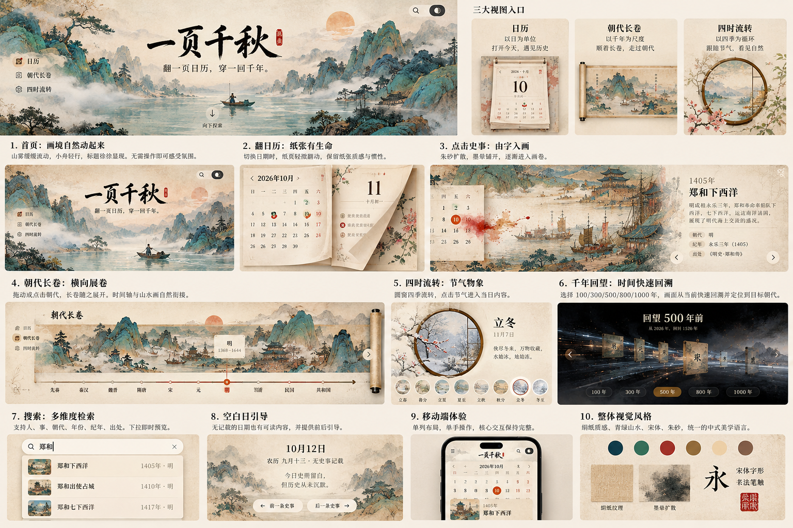

# 一页千秋 · v2 设计系统与还原基线

版本：2026-10-24 · 第一轮设计系统复核

**设计风格确定为「绢本青绿 · 山水画册」：以古画构图为舞台，以纸页、卷轴、圆窗组织内容，以朱砂标记时间与行动。** 用户应感到自己正在翻阅一件会展开的历史作品。

本文件是 v2 后续开发的设计依据。本轮完成规范复核与设计系统样张修正，未完成业务页面重建，未宣称页面已还原。最终目标仍为完整还原用户提供的产品设计效果。

## 1. 依据与解释规则

视觉依据：用户提供的 1536×1024 产品设计总览，原样存档为 [reference-board.png](design/reference-board.png)。

- 原图包含主视觉、三视图说明、编号 1–10 的场景与手机示意。编号、说明标题、右上三张介绍卡是交付总览的编排，不直接做成网站栏目。
- 原图中的日期、天气、事件文字属于场景示例，不能作为日历算法或史料数据。原型可能包含示意性或不准确的字样，正式内容仍从可核对数据读取。
- 视觉冲突时按「用户本轮设计稿与明确要求 → 本文件 → tokens.css → 旧规范与现有实现」执行。现有实现不作为降低还原要求的理由。
- docs/设计系统.md、docs/交互规范.md、docs/v2工作计划.md 保留历史参考；其中与本文件冲突的字号、组件形态、布局与运动方向不再作为 v2 验收依据。
- 总览图没有原始图层、字体文件和独立屏幕尺寸。本文件中的尺寸、色值与锚点是本轮确定的执行基线，不冒称从源设计文件精确提取。后续通过同视口逐屏对照收敛。
- 静态设计稿决定画面与组件；交互时序以用户前述「翻页、展卷、入画、溯时」要求及本文为准，不能声称从静图读出了动画。

## 2. 本轮复核结论

**已有标准可作为基础，不能直接作为还原完成版。** 色彩分层、基本字阶和动效时长可以继承；品牌字体、构图、物理组件与素材体系需要重新落定。

| 检查项 | 当前证据 | 本轮决定 |
|---|---|---|
| 首屏构图 | 源码及已有截图为左对齐宋体标题、大幅浅色蒙版、红色进入按钮 | 改为中央书法题字、左右山势夹景、中央水面留白；左导航、右上工具始终可达 |
| 品牌字形 | 未发现本地品牌字体；系统宋体与参考笔锋差异明显 | 独立书法字标及落款章作为必需资产，系统宋体仅允许占位 |
| 日历 | 当前为两张独立圆角面板；换月使用 rotateY + translateX | 形成一件纸历/书册的左右页；主运动纵向，局部纸角卷曲为辅 |
| 史事阅读 | 当前全屏暗色底部字幕 | 默认浅色画境，左侧画作、右侧纸面题跋，与参考 3 一致 |
| 长卷 | 当前每朝一屏图片加大浮卡；底部轴过于抽象 | 窄长山水带、可见卷杆、细时间轴、轻量时期签；事件详文进入画境阅读 |
| 四时 | 当前 24 节气文字环，中间为文字圆盘 | 画作圆窗、窗框、季节枝叶、右侧释义、底部圆形小景；24 节气仍完整可选 |
| 回望 | 当前深色数字面板 | 夜色山水、纪年牌、纵深路径与底部五档距离；动画层次独立于阅读页 |
| 色彩 | 原注释只对 paper 声明对比度 | 校验纸底、题跋底、组件底与主题状态，不能拿一组比值代表全站 |
| 日期选中态 | 当前为淡红方格 | 正式选中态用朱砂圆印；今天另用细圈或小记号，语义分别标识 |
| 材质与圆角 | 当前统一圆角 18px，程序噪点覆盖全屏 | 真正的绢纹、纸纤维、卷边和木/铜框分别建层；纸与题跋采用小圆角 |

本轮对比度复算发现：深色四季文字不合格；深色朱砂按钮沿用白字不合格；旧朝代可读色在深色 paper-2/card 上有 26 组不合格。已在设计令牌中提供修正版；业务脚本和组件尚需在后续迁移时接入。

## 3. 风格与构图

### 3.1 画面语言

- 绢本设色、石青石绿、暖赭纸底、松烟墨字、克制朱砂。近山轮廓清楚，远山褪色，水面和云雾形成可容字的留白。
- 山水承担主要视觉信息；信息纸面与山水在边缘自然融合。避免铺大块半透明白色把画作整体洗灰。
- 纸历、题跋、卷杆、月洞窗各有自己的材质与轮廓。普通按钮不做成大型艺术装置。
- 字体以宋体建立正文气质；品牌以书法形成辨识。正文保持可选择、可复制的 HTML，不烘焙进画作。
- 朱砂用于选中时间与明确行动；赭金/木色用于装裱和时期；青绿与石青主要属于山水。不能把整站文字随朝代染色。
- 不以通用圆角卡片墙、玻璃毛玻璃面板、夸张阴影或纯黑底字幕代替参考中的书册和题跋。

### 3.2 构图基线

工作验收视口：桌面 1440×900，次检 1536×864；平板 768×1024；手机 390×844，窄屏 320×740。均以 CSS 像素计；截图另记录 DPR。它们是工程工作基线，不是总览图中小图的原始设计尺寸。

| 场景 | 桌面布局基线 | 必须保持的视觉锚点 |
|---|---|---|
| 首屏 | 一屏画境，不设置通用正文版心；字标水平中心约 x=48%，顶部约 y=17%，宽约视口 30–36% | 两岸山势包围中心留白；朱日位于上半部偏右；舟在水面；副题在字标下；探索提示位于下方 |
| 常驻导航 | 左侧宽 144px，实际图标与文字组宽约 110px；边距 24–40px | 日历/朝代长卷/四时流转带同风格小图标；当前项有朱砂或赭色浅印记；不占实色侧栏 |
| 顶部工具 | 右上距边 24px，搜索和主题并列；图标视觉 18–20px，点击区 44px | 参考中的轻胶囊与深色主题开关，不能移到左下才可找到 |
| 日历 | 一个书册整体居中，建议宽 960–1120px；月历页与日签页约 1:1，中央有书脊/纸缝 | 年月作为同一语义行；月历七列；日签大字与物候装饰；避免两个相互无关的面板 |
| 入画 | 画作占约 68%，右侧题跋约 32%；题跋宽 360–440px，边界柔和过渡 | 默认浅纸黑字；年份→标题→叙述→朝代/纪年/出处；前后箭头靠近画面下方两端 |
| 长卷 | 纸底之上横向卷幅，画带约占屏高 48–62%；画幅下为时间轴，末端可见卷杆 | 左侧标题，山势连续，当前时期签悬于对应时间点；不拿大题跋遮住半幅画 |
| 四时 | 主体左圆窗、右释义；圆窗直径约 360–460px；底部 8 个可见小景节点 | 双层木/铜窗框、窗外应季枝叶、窗内画作；其余 24 节气通过横向浏览和前后选择可达 |
| 回望 | 独立夜色深景，标题在上，纪年牌沿路径退远，五档选择在下 | 100/300/500/800/1000 年；当前档朱赭色实底；主场景不被一块大黑卡覆盖 |
| 搜索 | 从右上工具展开的纸质检索面，桌面宽 520–680px | 顶部检索行，结果左缩略图、中标题、右年份/朝代；原画境仍可辨认 |
| 空白日 | 山水纸面中间排日期、真实农历与留白解释；底部前后寻史 | 留白也有完整构图，不是错误提示或空盒子 |

首屏与画境的背景需按视口重新取景。全图等比裁切时若切掉太阳、舟、峰顶或题字留白，必须提供不同构图资源，不能靠拉伸解决。

### 3.3 手机适配

- 手机保留画作与内容的关系，重排为画作在上、文字在下，不能把整张桌面截图缩小。
- 顶部紧凑品牌、菜单、搜索、主题；三视图收进可发现的菜单/底部导航，阅读过程中保持返回可见。最终手机画面以总览中的示意为视觉方向。
- 390px 下左右内边距 16px；320px 下 12px。正文 16px，出处/标签 12px；一行七列日历在 320px 时允许约 36px 宽日期目标，行高至少 44px，目标不重叠。
- 通用按钮触区至少 44×44px；日期窄屏特例需单独记录，不能宣称全部都是 44px 宽。圆形小景横向滑动但页面本身不横向溢出。
- 刘海和底部手势区使用 safe-area-inset。题跋随内容自然伸长，可滚动；不把文字压在画作底部裁切。

## 4. 色彩与主题

实现源：[css/tokens.css](css/tokens.css)。色值是本轮执行标准；画作天然包含更丰富的颜料变化，不用六色量化替代原画。

| 角色 | 浅色令牌/值 | 深色值 | 用法 |
|---|---|---|---|
| 绢纸底 | paper · #F4EFE6 | #14120F | 页面与山水留白连接 |
| 题跋纸 | paper-2 · #FBF8F2 | #191712 | 信息承载面 |
| 局部纸页 | card · #FCFAF5 | #1E1B16 | 历页、检索行底 |
| 主墨 | ink · #1F1D1A | #EDE6DA | 标题、正文 |
| 次墨 | ink-2 · #4A443B | #CFC6B7 | 次级正文 |
| 辅助墨 | muted · #675E52 | #A79C8B | 出处、说明与标签 |
| 朱砂 | zhu · #B23A2E | #E06A52 | 选中日期、行动、落款 |
| 朱砂上的字 | on-zhu · #FFF9F4 | #14120F | 必须成对使用；深色朱砂不反白 |
| 青绿文字 | qing · #3E6B62 | #7FB2A6 | 节气与青绿相关可读强调 |
| 赭金文字 | gold · #826631 | #C4A366 | 年份与时期 |
| 装饰颜料 | blue #123F48 / pine #326C58 / ochre #8C6B35 / sand #EED4AD / bark #805F49 | 保留画作本色，必要时局部压暗 | 装裱与画作辅助色，未经校验不能直接作小字 |

色阶禁止混用：whisper 只做装饰；era 是时代装饰色；era-ink 是可读文字色。朝代可读色统一由 `--era-<key>-ink` 提供，后续废止业务脚本内的重复十六进制表。

| 时期 key | 浅色文字 | 深色文字 |
|---|---|---|
| xia | #866647 | #A68565 |
| cq | #65714D | #84906B |
| qin | #39332C | #968A79 |
| han | #9A3C2E | #D07061 |
| sj | #5B6A79 | #7D8D9D |
| sui | #795B45 | #A6846B |
| tang | #94631B | #C28223 |
| wudai | #6A6053 | #958A7B |
| song | #4B7567 | #6A9586 |
| yuan | #4E5A8B | #7F8AB7 |
| ming | #AE3F2F | #D46D5D |
| qing | #3D6A8B | #6091B4 |
| minguo | #6D594D | #9E8779 |
| prc | #B0392E | #D66B60 |

四季保留既有浅色组合，深色使用春 #9ABCAB、夏 #83B4A9、秋 #D4B273、冬 #A8B3DE。只改变画境色温、枝叶与装饰，不重染正文。

浅色是参考稿的主验收模式。深色为夜观版本，使用独立文字色与纸面；不能简单反相，也不能把所有时期画作统一套同一层黑蒙版。回望本身是固定的夜色艺术场景，与全站明暗开关分开。

## 5. 字体、字阶与排版

### 5.1 字体角色

| 角色 | 定稿要求 | 当前资产状态 |
|---|---|---|
| 品牌「一页千秋」 | 与参考笔锋接近的定稿书法字标，优先本地 SVG 或透明高分辨率图；有可访问文字名称 | 缺失；系统宋体只能占位，不作为品牌完成态 |
| 落款印章 | 单独透明矢量/图片，细长章与参考比例一致；不拿红色圆角方块加宋体替代 | 缺失 |
| 标题/正文宋体 | 本地可分发、许可明确的中文宋体 WOFF2，锁定字体文件和字重；常规正文与中粗标题两档 | 尚无本地文件；现有系统字体栈可用于开发占位 |
| 操作黑体 | 简洁黑体，标签、输入和辅助操作；本地字体或明确系统栈 | 可复用系统栈，跨平台截图单列核验 |
| 日期/年份 | 静态历页优先使用正文宋体的数字；快速回望数字使用 tabular-nums | 不将所有纪年强制设为等宽代码字体 |

品牌的形体、长宽比、墨色边缘与印章位置属于资产验收项。正文 HTML 即使底图未到也必须可读；关键内容不转曲。

### 5.2 字阶

| 使用处 | 桌面 | 手机 | 行高/字距 |
|---|---|---|---|
| 书法字标 | 宽 clamp(256px,32vw,520px)，高度随资产比例 | 宽约视口 65–75%，不与工具重叠 | 使用资产自然比例 |
| 画境主标题 | 36–48px | 28–32px | 1.25 / .02em |
| 朝代/节气标题 | 32–40px | 26–30px | 1.3 / .04em |
| 日签大日期 | 88–112px | 64–80px | 1.05，避免极低行高截字 |
| 年月标题 | 24–28px，年月同字体同字号 | 22–24px | 1.4，不拆成大月小年 |
| 正文/史事叙述 | 16–18px | 16px | 1.85–1.95 / 0–.02em |
| 按钮/史事索引 | 14–16px | 14px | 1.5–1.7 |
| 纪年/出处/标签 | 12–13px | 12px | 1.6–1.8 / 0–.04em |
| 11px 特例 | 仅非关键信息的简短数字刻度 | 不用于操作或史料出处 | 不再全局用 .14em 拉开小字 |

阅读区宽约 24–32 个汉字，左对齐；长出处折行，不缩字号。书法/诗题可居中，正文不两端强行拉开。

## 6. 材质、形状、阴影与层级

间距继承 4/8/12/16/24/32/48/64/96/128；场景构图可使用比例锚点，不能强行把画幅坐标吸附到 4px 网格。

| 材质/组件 | 规格 |
|---|---|
| 绢本 | 细织纹、低频赭色沁染与纸纤维分层；纹理不直接覆盖文字墨色；不以高强度均匀噪点代替绢纹 |
| 历纸 | r-paper=3px 的视觉纸角、局部翘角、书脊暗部和两至三层纸边；纸影集中在纸角/卷边 |
| 题跋 | r-caption=2px；纸面稳定，纹理在背景层；避免 18px 圆角玻璃卡 |
| 按钮/输入 | r-control=6px；只有参考中的搜索、寻史与回望选项采用胶囊 |
| 印章/选中日期 | 印章使用资产；选中日为圆形朱砂印，日期字使用 on-zhu；今天与选中日可同时表达 |
| 圆窗 | 双层细框、木/铜色高光与内侧接触阴影；圆形裁切内画，枝叶在框外，不被一起裁掉 |
| 卷杆 | 顶/底轴头、卷材与接触影需成套；左右翻转不改变纹理光源方向 |
| 阴影 | 一致光源来自左上；e-1/e-2/e-3 只作为纸张抬升强度，不能给所有元素统一投浮卡阴影 |

绘制层顺序：画作 0 → 环境层 2 → 内容 10 → 导航 20/工具 30 → 局部浮层 40 → 入画 60 → 回望 70 → 检索 80 → 状态提示 90 → 焦点 100。

焦点环实际放在控件上且不得被父元素裁切；数值本身不能保证跨 stacking context 可见。雾、舟、纹理不接收鼠标事件、不进入辅助阅读顺序。关闭弹层后清理拦截层。

## 7. 组件契约与完整状态

| 组件 | 必须具备的状态与行为 |
|---|---|
| 视图导航 | 默认/hover/focus/当前；桌面始终可发现；手机菜单可开关；显示正确 aria-current |
| 日历格 | 默认、有公历记载、有农历记载、节气、今天、选中、今天且选中、非本月；色彩不是唯一标记，名称包含完整日期与状态 |
| 纸历/日签 | 日期与史事同步；切月不丢已选日期的语义；跨年、闰月、除夕按真实算法处理 |
| 史事入口 | 默认/hover/focus/按下；不强制等悬停才知道可点；键盘 Enter/Space 与触摸可进入 |
| 画境阅读 | closed/opening/reading/switching/closing/image-loading/image-error；返回、出处、排序上下文始终可达 |
| 前后事 | 显示「当日记载」「本时期」范围及当前序号；跨日/跨时期必须写明，不把列表邻接当作历史连续 |
| 长卷轴 | 默认/当前/聚焦/拖动/首端/末端；拖动之外提供箭头和时期按钮；标签保持正向可读 |
| 节气小景 | 默认/选中/focus/无图；圆窗与释义/日期一起更新；节点保持文字可读，不靠花叶颜色区分 |
| 回望 | 可选/运行/抵达/取消；年份以用户正在观察的年份为起点；目标无事件时说明只定位到时期 |
| 搜索 | 空输入/加载/命中/无结果/键盘当前项/关闭；能直接定位事件，并显示公历、农历或仅年份精度 |
| 空白日 | 无记载与筛选无命中分开；显示前后最近可达日期，写明目标日期；无结果时给出长卷入口 |
| 主题与动态开关 | 默认/按下/focus；语义名称与状态同步；静态模式保留所有功能 |

弹层视觉上可以是一幅铺满屏幕的画，同时保留 dialog 语义。打开时约束焦点并使背景 inert；退出时恢复来源控件与其所在视图。返回快照包括 view、selectedDate、筛选、各滚动容器 scrollLeft/scrollTop、所选节气与 focus，不只存 window.scrollY。

## 8. 运动语言

| 动作 | 时长 | 方向与要求 |
|---|---:|---|
| 点击与悬停反馈 | 140ms | 输入立即接收；140ms 是视觉反馈时长，不是等待时间 |
| 换日内容就位 | 220ms | 数字/内容轻微纵向就位，不让整本书每天重翻 |
| 换月翻页 | 280ms | 主运动沿纵向，rotateX 配合上下位移；默认从下缘提起下一页，反向镜像。原型的斜向翘角可作为局部纸形，不能退回整面横向滑动 |
| 展卷/朝代换色 | 500ms | 横向展卷；拖动跟手，释放后轻惯性；不劫持页面所有纵向滚轮 |
| 四时 | 500ms | 圆窗内景、枝叶与色温交接；下方小景仍按年内顺序排列，主体不变成文字转盘 |
| 入画 | 总计 750ms | 0ms 点击响应；0–375ms 墨从操作点扩开；120–600ms 画面接入；300–750ms 题跋就位；无图也可阅读 |
| 阅读中前后事 | 220ms | 仅换画和内容，不重复全屏墨晕 |
| 退出 | 280ms | 可从进入/阅读/切换任意阶段中断；撤销旧回调，立即可接收下一次操作 |
| 回望 | 850ms 回溯 + 500ms 抵达 | 数字、景深、时代色同源推进；停止后定位对应时期；公元前纪年不显示虚构的公元 0 年 |
| 环境 | 呼吸基准 4s；远雾28s、近雾36s、舟64s | 环境独立循环，幅度轻，离屏/后台暂停；不强制播放片头 |

键盘触发没有鼠标坐标时，从来源控件中心入画。快速连点、切换主题、退出后重进都必须取消旧动画与定时回调，不能出现旧事件覆盖新事件。

减少动态时直接显示最终状态、停止环境运动，所有动作仍可完成。暂停画境需要可见控件；自动长循环不应只能靠系统设置停止。

## 9. 素材系统与复用边界

完整的物料 ID、中文名称、建议文件名、状态和生成提示词统一记录在 [物料清单.md](物料清单.md)。本节只保留设计与复用原则；制作、替换和验收状态以该清单为准。

### 9.1 复用现有工程

- 复用 assets/data/ 中的史事、时期、节气及农历库，不复制第二份史料。保留公历/农历/仅年份的精度区别和出处。
- v2/js/data.js 中的数据适配、事件对象和画作映射可以复用；题材规则与年份适用范围需随着新画核对。
- 原图可用于开发占位和画风接近的局部，但须逐幅通过本稿的资产标准才能进入最终版。现有图片不能因路径已接入而自动算作合格。
- 重用思路和工具函数前检查时序与可中断性；旧 DOM、卡片样式、动画方向和文字环不会作为约束保留下来。
- 本轮不修改 v1、不修改 v2 业务 JS 与 app.css；后续应用只在 v2/ 开发。

### 9.2 必需资产清单

| 资产组 | 数量/规格基线 | 当前状态与验收要求 |
|---|---|---|
| 主品牌字标+落款 | SVG 优先，或透明 2×位图；四字与落款分层 | 已生成透明位图；接入时优先 WebP，SVG 容器非转曲矢量 |
| 首屏横幅+手机构图 | 桌面建议≥2880px宽，手机≥1080px宽；分离舟/前后雾 | 已生成 16:9 桌面、9:16 手机和独立小舟/双雾；PNG 原生尺寸与 WebP 导出尺寸分别记录 |
| 绢/纸/斑驳纹理 | 3类可平铺素材，另有纸边/翘角蒙版 | 已生成三类纹理与纸边卷角；页面铺贴与叠加强度需组合验收 |
| 历册装裱 | 书脊、纸堆、翘角与轻花枝 | 已生成空白双页历册、翻页层与四季枝叶；真实日期由 HTML 输出 |
| 横向长卷 | 14时期画段，统一地平线/画法/光源；卷杆单独 | 十四画段、十三专用过渡和左右木轴已生成；整卷接缝在组合时验收 |
| 史事画境 | 以事件语义取图，关键示例「郑和下西洋」有对应海船港湾场景 | 已生成郑和与十类题材背景，右侧渐隐保留阅读区 |
| 四时圆窗 | 1套窗框+4季外枝层+24节气内景与小景映射 | 窗框、四季外枝和二十四张独立节气画均已生成 |
| 回望场景 | 夜色山水底、可分离纪年牌、路径光迹/尘粒 | 夜景与透明纪年牌已生成；动态光迹/尘粒随页面实现 |
| 图标 | 视图、搜索、主题、返回、箭头、暂停，同一笔触和线宽 | 统一矢量；已有图标可择用，禁止混用 emoji |
| 正文字体 | 本地 WOFF2，许可/来源记录 | 已入库思源宋体 CN VF 2.003R 与 OFL 许可；使用 400/600 字重 |

新增最终资产统一放 v2/assets/{brand,fonts,textures,calendar,scroll,seasons,lookback,icons}/，分离共享资料与 v2 专用表现。所有画作标注 AI 意象/非实录；不可把艺术图当史料复原。

每项资产记录用途、源文件、尺寸、透明通道、裁切锚点、来源/许可、替换状态和验收截图。整张产品总览只用于比对，不裁出小画面放大当最终素材。

## 10. 可读性与检查方法

- 正文与操作信息的对比度要求 ≥4.5:1；大字阈值为常规24 CSS px或粗体约18.667 CSS px，才可使用3:1。旧规范写成19px/14px是单位错误。依据：[W3C 对比度说明](https://www.w3.org/WAI/WCAG22/Understanding/contrast-minimum.html)。
- 本项目通用触区目标44px；WCAG 2.2 AA最低是24×24px及其例外，不能把44px误写为AA最低。依据：[W3C 触区说明](https://www.w3.org/WAI/WCAG22/Understanding/target-size-minimum.html)。
- 对比度计算必须比较实际前景与实际背景，alpha、纹理、图像和混合层必须另测。单纯色对合格不代表画面上的文字合格。
- 不能通过四舍五入把4.499算成4.5通过。计算判断用原值，展示值可保留两位。
- 静态审计脚本：`python3 v2/design/audit-design-system.py`。报告 [contrast-audit.json](design/contrast-audit.json) 区分新规范和旧业务表；原始发现见 [contrast-before.json](design/contrast-before.json)。
- 新样张动态读取 CSS 令牌和朝代数据，展示当前主题/纸面的实际色对，不再硬编码浅色结果。

## 11. 100% 还原的验收路径

“100%”是最终目标，不以功能完成率或自动化检查替代视觉验收。顺序是**构图 → 关键资产 → 字形排版 → 材质色彩 → 组件细节 → 动态衔接**。

1. 从总览建立首屏、日历、入画、长卷、四时、回望、搜索、空白日、手机九类独立场景清单。风格面板作为全站基准。
2. 在 1440×900 和390×844 固定浏览器/DPR、字体加载、选中日期、事件、节气、主题、滚动位置与环境动画时刻。比如入画用1405年郑和事件、四时用立冬、回望选500年；不得为凑示例捏造10月10日史事。
3. 先制作可独立核对的逐屏静态基准图。它们从参考构图展开到工作视口，不冒称原始Figma导出；仍需与总览逐项核对。
4. 截图叠合检查关键锚点：品牌、导航、工具、纸册边、圆窗、题跋分界、卷杆、时间轴、选中日期、回望牌。原尺寸基准具备后，关键锚点偏差控制在4 CSS px内，字体角色/换行/材质形态不得替代；这是工作门槛，不单独代表100%还原。
5. 检查长文、无图、图片失败、空结果、跨年、窄屏、深色和减少动态等变体，不能只挑一张正常状态截图。
6. 动效另外验收点击位置入画、随时退出、连续阅读、原位返回、展卷跟手、回望落位与四时画面交接。
7. 视觉差异逐项记录，注明已修复/待修复及对应截图。最终由逐屏比对和用户视觉确认共同收口，不用全图像素相似度掩盖关键资产差异。

本轮证据：源码检查、用户原图、已有 docs/v2-01-首屏.png / v2-04-展卷.png / v2-05-四时.png，以及静态颜色计算。已有截图只说明历史实现外观，不是本轮新渲染证据。本轮浏览器 file:// 访问被安全策略阻止，未绕过；当前样张的视觉和交互渲染仍待后续浏览器验收。

## 12. 后续实施入口

- 第一项：补品牌题字、首屏构图与纸/绢材质，完成首屏静态基准；同时接入本轮新令牌，清理业务中的色表和反白硬编码。
- 第二项：落实纸历→入画→阅读→原位返回的完整链路，按浅色画境与右侧题跋构图开发。
- 第三项：横向长卷、圆窗四时、纵深回望分别按独立场景开发，不以旧骨架直接宣告完成。
- 第四项：搜索、空白日、手机、深色与减少动态全状态验收，再逐屏收敛差异。

本轮以设计系统复核完成为终点。素材生产、业务重建、部署和发布均不计为本轮已完成工作。
