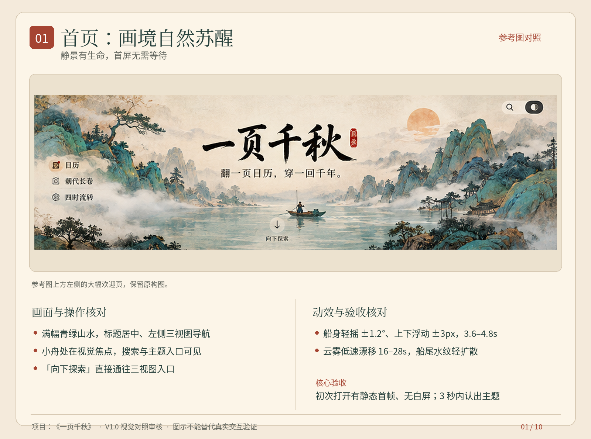
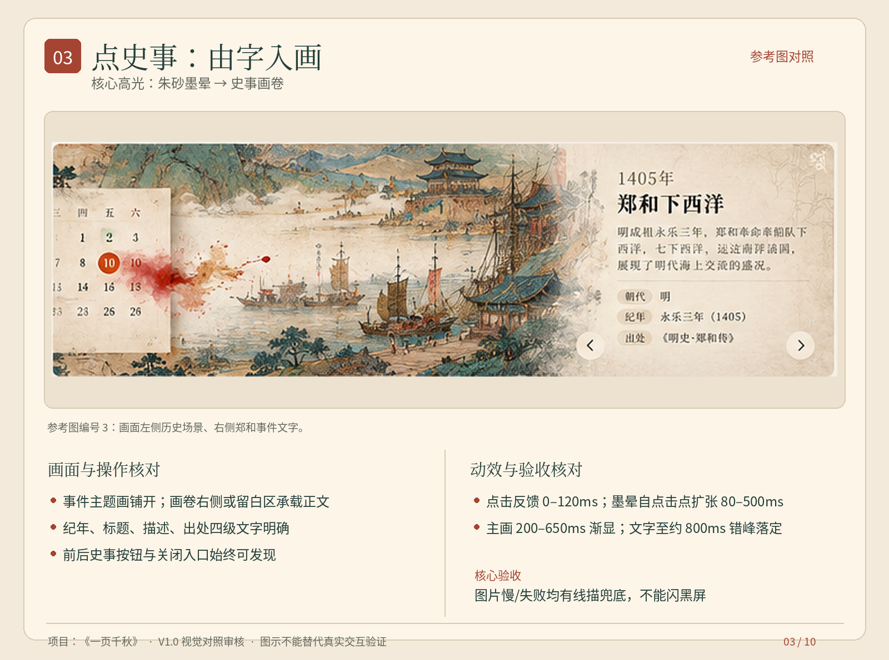
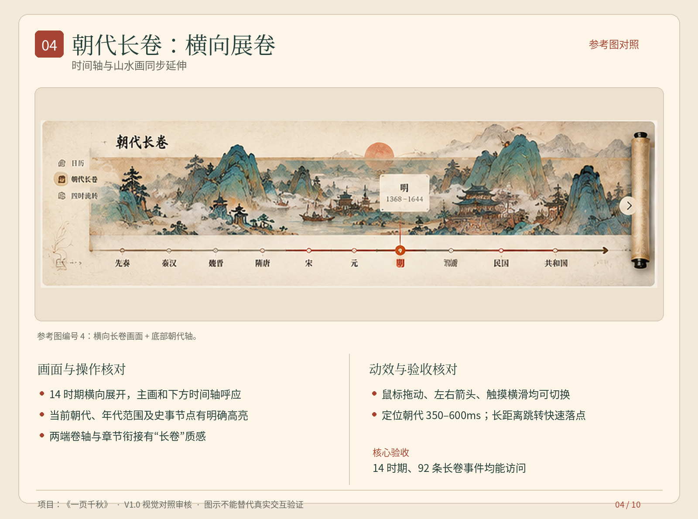
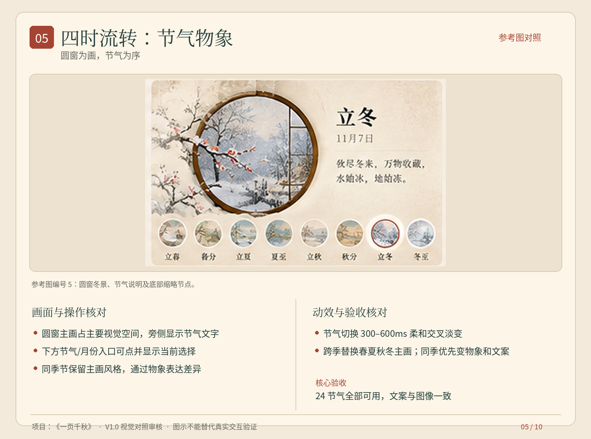
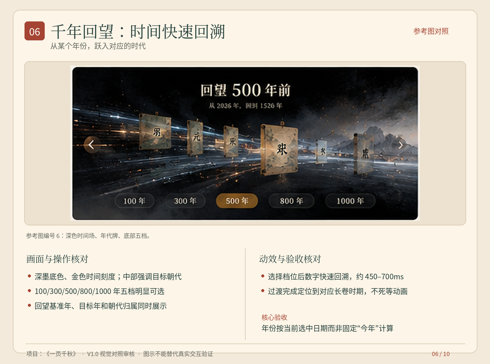
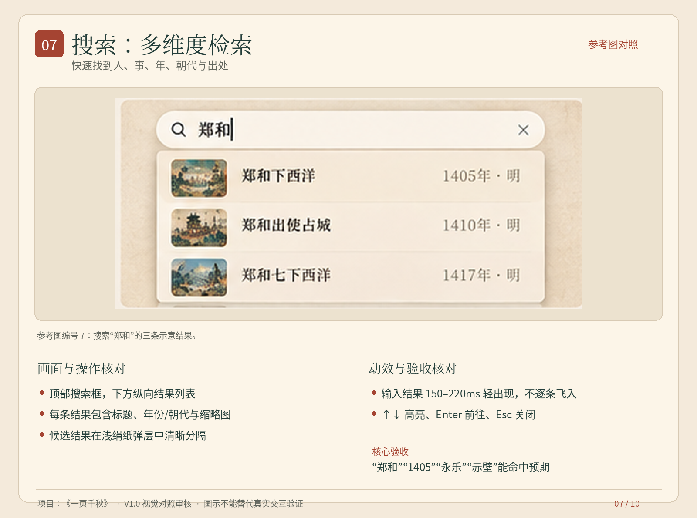
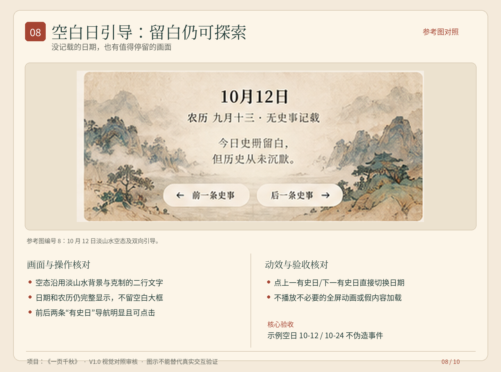
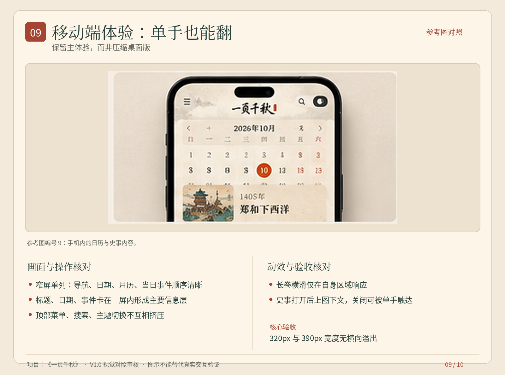
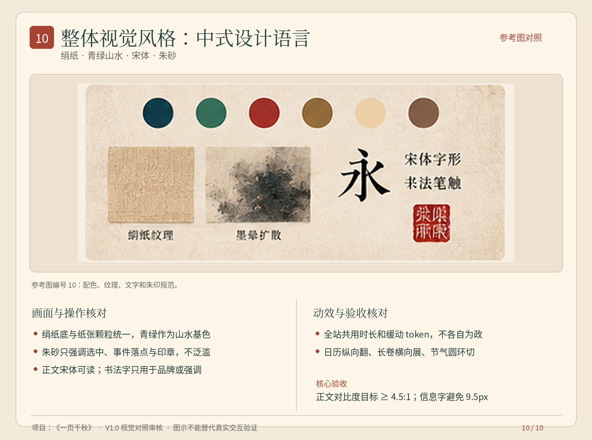

# 一页千秋｜10 场景图文审核说明（按原参考图拆分）

> 状态：目标效果审核基准（不是已实现或已测试结论）。
> 图片来源：原参考图的 10 个编号场景，按区域原样裁切；单独审核卡在图片外新增文字，不更改原图主体。
> 原图为合成概念稿，其中日期、画面内史事文字可能仅具示意意义；最终以本地事件清单和项目源码为准。
> 由于原参考图为 1536×1024 的拼版图，部分独立区域只有约 320–450 像素宽；放大后可能略模糊，不能据此判定实际 UI 清晰度。

## 统一审核方法

采用“视觉还原 → 操作路径 → 动效时序 → 边界/降级 → 通过/不通过”五步检查。每项建议记录：测试日期、设备/浏览器、操作录屏、结论、问题截图、严重级别。
视觉匹配以参考图的布局、构图和视觉语言为准；动效不可从静帧直接推断，以下为原有开发规格中的目标交互。

## 01｜首页：画境自然苏醒（S00）

**目标感受：** 静景有生命，首屏无需等待

- 原图裁切：`原图裁切/01_画境自然苏醒.png`
- 参考图对应：参考图上方左侧的大幅欢迎页，保留原构图。

### 画面与内容

- 满幅青绿山水，标题居中、左侧三视图导航
- 小舟处在视觉焦点，搜索与主题入口可见
- 「向下探索」直接通往三视图入口

### 操作与动效

- 船身轻摇 ±1.2°、上下浮动 ±3px，3.6–4.8s
- 云雾低速漂移 16–28s，船尾水纹轻扩散
- 暂停或减少动态后，静态画面仍完整

### 验收检查（建议逐项打勾）

- [ ] 初次打开有静态首帧、无白屏；3 秒内认出主题
- [ ] 三个入口及探索按钮都可点，背景动画不挡操作
- [ ] 无船背景 + 透明小舟，不能出现“重影双船”
- [ ] 提供实际运行录屏，与参考图在主要布局和视觉比例上进行对照。
- [ ] 检查减少动画、移动窄屏、资源失败时仍可完成核心操作。

**审核结果：** ☐ 通过　☐ 有条件通过　☐ 不通过　|　问题链接/说明：________

---

## 02｜翻日历：纸张有生命（S10）

**目标感受：** 翻页清晰，不阻碍选日

- 原图裁切：`原图裁切/02_纸张有生命.png`
- 参考图对应：参考图编号 2：月历纸页 + 翻页卷角。

### 画面与内容

- 42 格月历与公农历文字完整可读
- 选中日使用朱砂强调；有史日与农历纪事标识区分
- 页角卷起与纸张阴影体现“翻页”

### 操作与动效

- 切月轻翻 260–350ms，方向与操作一致
- 点日格即时高亮，右侧档案随选日同步变化
- 连点换月不排队播放动画；今天键可立即回跳

### 验收检查（建议逐项打勾）

- [ ] 闰年、跨月及月初月末 42 格正确
- [ ] 农历节令不固定绑定公历日，除夕按年计算
- [ ] 日历操作后页面不意外滚至顶部
- [ ] 提供实际运行录屏，与参考图在主要布局和视觉比例上进行对照。
- [ ] 检查减少动画、移动窄屏、资源失败时仍可完成核心操作。

**审核结果：** ☐ 通过　☐ 有条件通过　☐ 不通过　|　问题链接/说明：________

---

## 03｜点史事：由字入画（S20）

**目标感受：** 核心高光：朱砂墨晕 → 史事画卷

- 原图裁切：`原图裁切/03_由字入画.png`
- 参考图对应：参考图编号 3：画面左侧历史场景、右侧郑和事件文字。

### 画面与内容

- 事件主题画铺开；画卷右侧或留白区承载正文
- 纪年、标题、描述、出处四级文字明确
- 前后史事按钮与关闭入口始终可发现

### 操作与动效

- 点击反馈 0–120ms；墨晕自点击点扩张 80–500ms
- 主画 200–650ms 渐显；文字至约 800ms 错峰落定
- 后续事件轻量切换，关闭恢复来源位置与焦点

### 验收检查（建议逐项打勾）

- [ ] 图片慢/失败均有线描兜底，不能闪黑屏
- [ ] 画题符合事件语义；画作标注“艺术意象非实录”
- [ ] Esc/关闭按钮/移动返回均有效且可打断动画
- [ ] 提供实际运行录屏，与参考图在主要布局和视觉比例上进行对照。
- [ ] 检查减少动画、移动窄屏、资源失败时仍可完成核心操作。

**审核结果：** ☐ 通过　☐ 有条件通过　☐ 不通过　|　问题链接/说明：________

---

## 04｜朝代长卷：横向展卷（S30）

**目标感受：** 时间轴与山水画同步延伸

- 原图裁切：`原图裁切/04_横向展卷.png`
- 参考图对应：参考图编号 4：横向长卷画面 + 底部朝代轴。

### 画面与内容

- 14 时期横向展开，主画和下方时间轴呼应
- 当前朝代、年代范围及史事节点有明确高亮
- 两端卷轴与章节衔接有“长卷”质感

### 操作与动效

- 鼠标拖动、左右箭头、触摸横滑均可切换
- 定位朝代 350–600ms；长距离跳转快速落点
- 打开史事关闭后仍在原朝代、原横向位置

### 验收检查（建议逐项打勾）

- [ ] 14 时期、92 条长卷事件均能访问
- [ ] 网页纵向滚轮不被卷轴强行劫持
- [ ] 仅有年份的史事不伪装成有确切月日
- [ ] 提供实际运行录屏，与参考图在主要布局和视觉比例上进行对照。
- [ ] 检查减少动画、移动窄屏、资源失败时仍可完成核心操作。

**审核结果：** ☐ 通过　☐ 有条件通过　☐ 不通过　|　问题链接/说明：________

---

## 05｜四时流转：节气物象（S40）

**目标感受：** 圆窗为画，节气为序

- 原图裁切：`原图裁切/05_节气物象.png`
- 参考图对应：参考图编号 5：圆窗冬景、节气说明及底部缩略节点。

### 画面与内容

- 圆窗主画占主要视觉空间，旁侧显示节气文字
- 下方节气/月份入口可点并显示当前选择
- 同季节保留主画风格，通过物象表达差异

### 操作与动效

- 节气切换 300–600ms 柔和交叉淡变
- 跨季替换春夏秋冬主画；同季优先变物象和文案
- 进入时按真实交节时间定位当前节气

### 验收检查（建议逐项打勾）

- [ ] 24 节气全部可用，文案与图像一致
- [ ] 农历节日不误作“节气”；手机圆窗不越界
- [ ] 关闭动效后仍可完整查看四季与文字
- [ ] 提供实际运行录屏，与参考图在主要布局和视觉比例上进行对照。
- [ ] 检查减少动画、移动窄屏、资源失败时仍可完成核心操作。

**审核结果：** ☐ 通过　☐ 有条件通过　☐ 不通过　|　问题链接/说明：________

---

## 06｜千年回望：时间快速回溯（S50）

**目标感受：** 从某个年份，跃入对应的时代

- 原图裁切：`原图裁切/06_时间快速回溯.png`
- 参考图对应：参考图编号 6：深色时间场、年代牌、底部五档。

### 画面与内容

- 深墨底色、金色时间刻度；中部强调目标朝代
- 100/300/500/800/1000 年五档明显可选
- 回望基准年、目标年和朝代归属同时展示

### 操作与动效

- 选择档位后数字快速回溯，约 450–700ms
- 过渡完成定位到对应长卷时期，不死等动画
- 允许返回、Esc 或减少动态直接结束

### 验收检查（建议逐项打勾）

- [ ] 年份按当前选中日期而非固定“今年”计算
- [ ] 例如 2026 回望 500 年为 1526 → 明
- [ ] 历史纪年无公元 0 年；不伪造“同月同日史事”
- [ ] 提供实际运行录屏，与参考图在主要布局和视觉比例上进行对照。
- [ ] 检查减少动画、移动窄屏、资源失败时仍可完成核心操作。

**审核结果：** ☐ 通过　☐ 有条件通过　☐ 不通过　|　问题链接/说明：________

---

## 07｜搜索：多维度检索（S60）

**目标感受：** 快速找到人、事、年、朝代与出处

- 原图裁切：`原图裁切/07_多维度检索.png`
- 参考图对应：参考图编号 7：搜索“郑和”的三条示意结果。

### 画面与内容

- 顶部搜索框，下方纵向结果列表
- 每条结果包含标题、年份/朝代与缩略图
- 候选结果在浅绢纸弹层中清晰分隔

### 操作与动效

- 输入结果 150–220ms 轻出现，不逐条飞入
- ↑↓ 高亮、Enter 前往、Esc 关闭
- 正在使用中文输入法时不抢占 Enter

### 验收检查（建议逐项打勾）

- [ ] “郑和”“1405”“永乐”“赤壁”能命中预期
- [ ] 公历 / 农历 / 长卷来源清楚区分
- [ ] 无结果、无关键词和 320px 宽度均可用
- [ ] 提供实际运行录屏，与参考图在主要布局和视觉比例上进行对照。
- [ ] 检查减少动画、移动窄屏、资源失败时仍可完成核心操作。

**审核结果：** ☐ 通过　☐ 有条件通过　☐ 不通过　|　问题链接/说明：________

---

## 08｜空白日引导：留白仍可探索（S70）

**目标感受：** 没记载的日期，也有值得停留的画面

- 原图裁切：`原图裁切/08_留白仍可探索.png`
- 参考图对应：参考图编号 8：10 月 12 日淡山水空态及双向引导。

### 画面与内容

- 空态沿用淡山水背景与克制的二行文字
- 日期和农历仍完整显示，不留空白大框
- 前后两条“有史日”导航明显且可点击

### 操作与动效

- 点上一有史日/下一有史日直接切换日期
- 不播放不必要的全屏动画或假内容加载
- 跨月/跨年寻找真实有记录日

### 验收检查（建议逐项打勾）

- [ ] 示例空日 10-12 / 10-24 不伪造事件
- [ ] 不得写成“今天历史上没有发生过事”
- [ ] 左右按钮有明确目标日期并正确定位
- [ ] 提供实际运行录屏，与参考图在主要布局和视觉比例上进行对照。
- [ ] 检查减少动画、移动窄屏、资源失败时仍可完成核心操作。

**审核结果：** ☐ 通过　☐ 有条件通过　☐ 不通过　|　问题链接/说明：________

---

## 09｜移动端体验：单手也能翻（S80）

**目标感受：** 保留主体验，而非压缩桌面版

- 原图裁切：`原图裁切/09_单手也能翻.png`
- 参考图对应：参考图编号 9：手机内的日历与史事内容。

### 画面与内容

- 窄屏单列：导航、日期、月历、当日事件顺序清晰
- 标题、日期、事件卡在一屏内形成主要信息层
- 顶部菜单、搜索、主题切换不互相挤压

### 操作与动效

- 长卷横滑仅在自身区域响应
- 史事打开后上图下文，关闭可被单手触达
- 低端设备自动降级复杂雾层与重叠效果

### 验收检查（建议逐项打勾）

- [ ] 320px 与 390px 宽度无横向溢出
- [ ] 42 格可点且不误触，字体和对比度可读
- [ ] 软键盘、浏览器返回、底部安全区均正常
- [ ] 提供实际运行录屏，与参考图在主要布局和视觉比例上进行对照。
- [ ] 检查减少动画、移动窄屏、资源失败时仍可完成核心操作。

**审核结果：** ☐ 通过　☐ 有条件通过　☐ 不通过　|　问题链接/说明：________

---

## 10｜整体视觉风格：中式设计语言（S90）

**目标感受：** 绢纸 · 青绿山水 · 宋体 · 朱砂

- 原图裁切：`原图裁切/10_中式设计语言.png`
- 参考图对应：参考图编号 10：配色、纹理、文字和朱印规范。

### 画面与内容

- 绢纸底与纸张颗粒统一，青绿作为山水基色
- 朱砂只强调选中、事件落点与印章，不泛滥
- 正文宋体可读；书法字只用于品牌或强调

### 操作与动效

- 全站共用时长和缓动 token，不各自为政
- 日历纵向翻、长卷横向展、节气圆环切
- 亮暗主题都保留纹理和足够的文字对比

### 验收检查（建议逐项打勾）

- [ ] 正文对比度目标 ≥ 4.5:1；信息字避免 9.5px
- [ ] 不得增加无功能的大量装饰层
- [ ] 无外部 CDN、字体或运行时 API 依赖
- [ ] 提供实际运行录屏，与参考图在主要布局和视觉比例上进行对照。
- [ ] 检查减少动画、移动窄屏、资源失败时仍可完成核心操作。

**审核结果：** ☐ 通过　☐ 有条件通过　☐ 不通过　|　问题链接/说明：________

---

## 统一阻断项（P0）

- 实际历史日期、朝代或节气归位错误，或把仅有年份的长卷事件写入确定的日历日期。
- 首屏白屏、图片失败后黑屏、动画卡死或无法退出、资源需要联网才能运行。
- 画卷关闭不能恢复原位置；键盘无法退出；移动端核心内容无法阅读或点击。
- 历史事件配画明显不符且没有“AI 生成艺术意象，非事件实录”标注。
- 影响正文阅读的文字对比度不足或字体过小。

## 截止前复核顺序

建议先审 01 → 02 → 03 → 08 → 09 → 10，确保首屏与核心体验成立；再审 04、05、06、07。

## 实施注意

- 技术前提：单页、零外部运行时依赖、不接在线 API、无 Service Worker。
- 全站统一日历纵向翻页、长卷横向展卷、四时循环流转的运动语义。
- 图片清单应映射到事件真实记录；参考图无法直接证实图片在本地资产库中是否存在。
- 首页分层需确认“无船背景 + 独立透明小舟”，否则无法正确摇摆。
- 页面静态图可审核布局/风格，动效流畅度需要真实浏览器录屏、目标设备上的操作验证。
